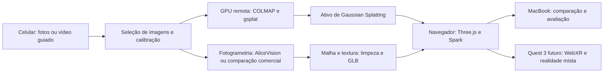

# Imersity — pesquisa técnica e plano de POC

Pesquisa consultada em **21 de outubro de 2026**. Escopo: reconstruir rosto e cabelo de uma pessoa com alto realismo, visualizar no navegador e preparar uma futura experiência de realidade mista no Meta Quest 3.

**Equipamento disponível:** celular para captura e MacBook para navegador. O Quest 3 ainda não foi comprado. Modelo do celular e configuração do Mac não informados.

**Status:** pesquisa documental e proposta de experimentos. Nenhum algoritmo foi executado com fotos do usuário; nenhum resultado foi medido em Quest. Capacidades publicadas e resultados de artigos são identificados como tais. As metas propostas abaixo são critérios de engenharia, não promessas dos fornecedores.

## 1. Recomendação

Há evidência científica e comercial suficiente para justificar a POC. O caminho inicial recomendado é **capturar uma pessoa com celular e comparar, com as mesmas imagens, uma reconstrução por Gaussian Splatting e uma malha texturizada**. A primeira prioriza aparência fotográfica; a segunda permite inspecionar a forma e preparar cabelo independente.

O MacBook pode ser o posto de visualização e controle. Os processamentos que exigem CUDA devem rodar em uma GPU NVIDIA remota por tarefa. A entrega ao usuário pode continuar sendo um site; o processamento pesado não precisa ocorrer no navegador.

A primeira decisão de investimento deve vir de uma reconstrução convincente no Mac. Depois, um Quest emprestado ou alugado pode validar a apresentação estéreo e a fluidez, antes da compra.

O desafio é atender simultaneamente a quatro requisitos:

| Requisito | Pergunta da POC | O que não comprova isso |
|---|---|---|
| Identidade visual | A pessoa se reconhece de frente, de perfil e em movimento? | Uma imagem frontal bonita |
| Fidelidade geométrica | Nariz, testa, mandíbula, orelhas e proporções estão corretos? | Textura fotográfica projetada sobre forma aproximada |
| Modularidade | Podemos ocultar ou trocar cabelo preservando o rosto? | Cabeça e cabelo fundidos em um único volume |
| Entrega interativa | O ativo roda localmente no navegador com qualidade aceitável? | Vídeo pronto ou visualizador que depende de renderização no servidor |

**Rosto estático fotorrealista é um objetivo tecnicamente fundamentado. Um gêmeo métrico, com cabelo removível, a partir de três fotos quaisquer e com qualidade uniforme em todas as pessoas, continua sendo hipótese a validar.**

## 2. O que a Crisalix realmente demonstra

### H3D-Net e SIRA++

O **H3D-Net, ICCV 2021**, foi publicado por pesquisadores da Crisalix, UPC e IRI. Reconstrói a cabeça usando uma representação implícita de superfície e conhecimento prévio aprendido de scans. A página demonstra reconstruções com três vistas, mas usa também máscaras e poses de câmera; em exemplos, as máscaras tiveram refinamento manual. Isso é evidência de viabilidade, com condições de entrada relevantes para reproduzir o resultado. [Projeto H3D-Net](https://crisalixsa.github.io/h3d-net/), [artigo ICCV](https://openaccess.thecvf.com/content/ICCV2021/html/Ramon_H3D-Net_Few-Shot_High-Fidelity_3D_Head_Reconstruction_ICCV_2021_paper.html).

O **SIRA++, TPAMI 2025**, estende essa linha com modelos prévios de forma e aparência, pré-treinados em 10 mil scans, ajuste de superfície SDF e renderização diferenciável. Publica resultados com uma ou poucas imagens. O conhecimento aprendido ajuda a completar o que não foi observado; não transforma áreas invisíveis em medições do indivíduo. A página não fornece uma implementação completa pronta para incorporarmos ao produto. [Projeto SIRA++](https://crisalixsa.github.io/sira-plus-plus/).

O repositório **H3DS** contém dados e ferramentas de avaliação, não o motor comercial completo. Seus utilitários têm licença MIT, mas o dataset tem restrições de pesquisa não comercial. Não devemos confundir as duas licenças. [H3DS](https://github.com/CrisalixSA/h3ds).

### Integração comercial

A Crisalix publica API com autenticação, processamento assíncrono e webhooks, além de **Player.js** para incorporar seu visualizador. Isso torna uma avaliação comercial pertinente. As páginas consultadas não comprovam exportação livre de cabeça/cabelo em GLB, cabelo separado ou suporte desse player ao WebXR do Quest. Os exemplos públicos da API incluem procedimentos mamários; o escopo facial necessário precisa ser confirmado com o fornecedor. [API](https://api3d.crisalix.com/docs), [Player.js](https://api3d.crisalix.com/docs/player.js).

A instrução de criação facial solicita a distância interpupilar do paciente. É um exemplo concreto de referência física adicional para escala. [Procedimento oficial](https://help.crisalix.com/en_US/face-photos-creating-a-face-3d-model).

**Decisão:** usar Crisalix como referência técnica e possível benchmark comercial. Não depender de um acesso/exportação que ainda não foi demonstrado. As estatísticas comerciais do brief original não foram usadas como evidência da qualidade de reconstrução.

## 3. Tecnologias de reconstrução

| Família | Resultado | Vantagem para Imersity | Limitação principal | Papel na POC |
|---|---|---|---|---|
| Fotogrametria / SfM / MVS | Malha e textura a partir de vistas sobrepostas | Forma explícita, inspeção em clay, exportação | Movimento, reflexos e cabelo fino prejudicam reconstrução | Ramo geométrico inicial |
| Modelos faciais paramétricos | Cabeça ajustada a uma base estatística | Topologia consistente e regularização | Pode aproximar identidade; cabelo requer outro sistema | Inicialização ou comparação posterior |
| NeRF | Campo neural de aparência | Síntese de vistas detalhada | Renderização/exportação e edição exigem trabalho adicional | Referência científica, sem prioridade inicial |
| 3D Gaussian Splatting | Gaussianas com posição, forma, opacidade e aparência | Boa rota para preservar a imagem capturada em visualização interativa | Não entrega automaticamente malha, materiais ou cabelo modular | Ramo visual inicial |
| Avatares relightable/híbridos | Geometria e aparência com controle de iluminação | Integração visual mais coerente com novos ambientes | Mais componentes, hipóteses e restrições de licença | Pesquisa após o baseline |

**Fotogrametria:** COLMAP recupera posições de câmera e estrutura a partir de imagens sobrepostas; MVS acrescenta densidade. O manual recomenda iluminação consistente e cada parte visível em várias imagens. “Cada parte vista em três fotos” não significa “três fotos para toda a cabeça”. [COLMAP](https://colmap.github.io/tutorial.html).

**Gaussian Splatting:** Nerfstudio implementa Splatfacto sobre gsplat. A documentação registra exportação de Gaussianas em PLY e não oferece uma conversão direta equivalente para malha limpa. Um PLY pode guardar diferentes tipos de dados; um arquivo de splats não deve ser tratado como malha convencional. [Splatfacto](https://docs.nerf.studio/nerfology/methods/splat.html).

**FLAME, DECA, EMOCA e MICA:** FLAME é um modelo de cabeça; DECA acrescenta estimação de detalhe, EMOCA concentra-se em expressão e MICA em forma métrica aprendida. São candidatos úteis, mas seus resultados precisam ser comparados com o indivíduo, principalmente em perfil. O nome “metrical” não dispensa calibração e avaliação. [DECA](https://github.com/yfeng95/DECA), [EMOCA](https://github.com/radekd91/emoca), [MICA](https://wojciechzielonka.com/mica/).

### Trabalhos recentes selecionados

| Trabalho | Contribuição relevante | Disponibilidade e cuidado |
|---|---|---|
| GaussianAvatars, CVPR 2024 | Gaussianas vinculadas a malha facial, com controle de expressão/pose | Código publicado; licenças não comerciais e dependências adicionais. [Repositório](https://github.com/ShenhanQian/GaussianAvatars) |
| HRAvatar, CVPR 2025 | Avatar a partir de vídeo com atributos físicos e reiluminação | Código disponível; revisar modelos e submódulos além da licença principal. [Repositório](https://github.com/Pixel-Talk/HRAvatar) |
| LAM, SIGGRAPH 2025 | Cabeça Gaussiana animável a partir de uma imagem; renderer WebGL | Código Apache 2.0, pesos CC BY-NC 4.0; velocidade publicada em outro aparelho não comprova Quest. [Projeto](https://github.com/aigc3d/LAM), [pesos](https://github.com/aigc3d/LAM/blob/master/LICENSE_WEIGHT) |
| GTAvatar, Eurographics 2026 | Texturas editáveis e reiluminação a partir de vídeo | Código publicado; autores indicam 1–3 h e pelo menos 5 GB de VRAM, dependendo dos dados/GPU. Dependências FLAME2020/Graphdeco restringem uso. [Repositório](https://github.com/KelianB/GTAvatar) |
| MeshLAM, 2026 | Malha com UV a partir de imagem, alternativa interessante para ativos explícitos | Página anuncia resultados; não foi confirmada uma distribuição executável específica pronta. [Projeto](https://meshlam.github.io/) |
| RelightAnyone, 2026 | Cabeças Gaussianas reilumináveis a partir de uma ou várias imagens | Evidência científica; não foi identificada API comercial pronta na fonte. [Disney Research](https://studios.disneyresearch.com/2026/05/31/relightanyone-a-generalized-relightable-3d-gaussian-head-model/) |

Esses trabalhos orientam a evolução da POC. A primeira rodada deve privilegiar pipelines reproduzíveis com nossos dados e condições de uso compatíveis.

## 4. O que faz um rosto parecer real

Realismo resulta da combinação de forma, textura, olhos, iluminação e resposta dos materiais. Aumentar a resolução da textura não corrige uma mandíbula errada.

Para o ramo de malha, avaliar:

- Forma do rosto e assimetrias individuais, orelhas, transição do pescoço e linha capilar.
- Cor da pele sem embelezamento, pintas, sobrancelhas e pelos faciais.
- Normais e detalhe superficial; distinguir detalhe observado de detalhe sintetizado.
- Rugosidade e brilho da pele; aproximação de espalhamento subsuperficial no renderer.
- Olhos com geometria e reflexos coerentes, evitando aparência de olhos pintados.
- Bordas do cabelo, transparência, brilho anisotrópico e ausência de aparência de capacete.

Captura fotográfica comum mistura cor da superfície com sombras e reflexos. Essa aparência pode funcionar bem na luz original e parecer incorreta sob uma luz nova. A pesquisa **Digital Emily/Light Stage** demonstra por que capturar componentes difusas e especulares separadamente melhora o resultado reiluminável. É uma referência de qualidade; seu aparato não é requisito para começar com celular. [Digital Emily](https://vgl.ict.usc.edu/Research/DigitalEmily/), [Light Stages](https://ict.usc.edu/research/projects/light-stages/).

Na POC, produzir primeiro a melhor reconstrução na iluminação de captura. Em seguida, avaliar reiluminação em um experimento próprio. O modo clay ajuda a inspecionar geometria, mas não aumenta a precisão dos dados capturados.

Se o celular tiver TrueDepth, pode haver uma rota de captura com profundidade adicional. Entretanto, a malha de face tracking do ARKit é descrita pela própria Apple como uma malha grosseira ajustada ao rosto; não é, por si só, um scan de poros nem uma reconstrução de cabelo. [Apple ARFaceGeometry](https://developer.apple.com/documentation/arkit/arfaceanchor/geometry?language=_5).

## 5. Cabelo: a parte mais incerta para a evolução do produto

É preciso distinguir **aparência do cabelo atual**, **geometria dos fios**, **couro cabeludo sob o cabelo** e **simulação de outro corte**.

Uma captura visual pode preservar bem cor e volume aparente. Já os fios ocultos e o couro cabeludo não são observáveis diretamente. Remover o cabelo de um scan não revela automaticamente a anatomia que estava atrás dele. Separar pixels em máscaras 2D também não garante uma separação 3D consistente entre todas as vistas.

| Trabalho | O que oferece | Condição para uso |
|---|---|---|
| Neural Haircut, ICCV 2023 | Reconstrução de fios a partir de vídeo ou múltiplas vistas, com conhecimento prévio de cabelo | Implementação publicada para pesquisa; verificar licença antes de executar na POC comercial. [Código](https://github.com/Vanessik/NeuralHaircut) |
| MonoHair, CVPR 2024 | Recupera estrutura externa e infere estrutura interna conectada ao scalp | Código CUDA e licença CC BY-NC 4.0. [Código/licença](https://github.com/KeyuWu-CS/MonoHair) |
| Gaussian Haircut, ECCV 2024 | Combina fios explícitos e Gaussianas alinhadas; permite edição posterior | Autores relatam algumas horas em GPU. Código CC BY-NC-SA e termos adicionais. [Projeto](https://eth-ait.github.io/GaussianHaircut/), [licença](https://github.com/eth-ait/GaussianHaircut/blob/main/LICENSE.md) |
| DiffLocks, CVPR 2025 | Geração de fios a partir de imagem, incluindo exemplos cacheados/crespos | Partes invisíveis são inferidas; licença restringe finalidade comercial e oferece contato para licença própria. [Projeto](https://radualexandru.github.io/difflocks/), [licença](https://github.com/Meshcapade/difflocks/blob/main/LICENSE) |
| EfficientMonoHair, preprint de 2026 | Acelera reconstrução de fios por fusão de direções multivista | Relata 23 min em Hair20K sintético na RTX4090; o próprio artigo diz que dados reais demoram mais. Não foi confirmada implementação pública. [Artigo](https://arxiv.org/html/2604.05794v1) |
| CGHair, 2026 | Compressão de representação de cabelo com cards e Gaussianas compartilhadas | Promissor para memória; não comprova exportação GLB comum nem execução no Quest. [Projeto](https://humansensinglab.github.io/CGHair/) |

**Escolha inicial:** preservar cabelo atual no ramo visual; produzir uma base facial independente no ramo de malha. Depois testar dois cabelos conhecidos/licenciados sobre a mesma cabeça. Isso verifica a arquitetura modular antes de investir em reconstrução automática de todos os fios.

Para browser/mobile, começar com **hair cards**: pequenas superfícies com texturas de fios e transparência. Manter um master mais detalhado quando existir. Cards exigem ajuste de silhueta, transparência, LOD e brilho; não são automaticamente realistas. A própria Epic diferencia suporte/custo de strands e cards nas plataformas. [Groom: suporte](https://dev.epicgames.com/documentation/unreal-engine/groom-platform-support-in-unreal-engine?lang=en-US).

Não extrapolar sucesso em cabelo curto liso para cachos, crespos, tranças, coques, cabelos muito claros ou muito escuros. Esses casos devem entrar nas rodadas seguintes.

## 6. Empresas e produtos para comparação

| Solução | Capacidade documentada | Utilidade / ressalva para nossa POC |
|---|---|---|
| Crisalix | Reconstrução estética e incorporação por API/player | Comparar fidelidade; exportação independente e cabelo modular ainda precisam ser confirmados |
| Avatar SDK / MetaPerson | Avatar de foto, cabeça/cabelo, GLB/glTF/FBX, controles de exportação | Benchmark rápido de integração e identidade; REST MetaPerson exige Enterprise. [REST](https://docs.metaperson.avatarsdk.com/rest_api/), [JS/exportação](https://docs.metaperson.avatarsdk.com/js_api/) |
| Didimo | Geração de humano digital e estrutura de malhas para cabeça/olhos/boca | Comparação de qualidade e export; não assumir que reproduz fios individuais do cliente. [Especificação](https://developer.didimo.co/docs/digital-human-specification) |
| in3D | Captura de pessoas e exportação para aplicações 3D | O contrato tem restrições sobre distribuição e tecnologia concorrente; avaliar enquadramento do produto. [Portal](https://developer.in3d.io/) |
| Reallusion Headshot 3 + CC5 | Foto ou scan para cabeça editável, com refinamento assistido | Referência de qualidade com trabalho artístico; ferramentas anunciadas para Windows, sem API SaaS comprovada. [Produto](https://www.reallusion.com/character-creator/headshot/) |
| MetaHuman / Epic | Ferramentas avançadas de humano digital | Benchmark artístico; conversão e otimização para web exigem trabalho. Licenciamento atual permite outros engines, portanto o obstáculo não é uma exclusividade obrigatória do Unreal. [Licenciamento](https://www.metahuman.com/license?lang=pt-BR) |
| Meta Codec Avatars | Pesquisa e datasets de telepresença fotorrealista | Mostra o potencial da tecnologia; não equivale a uma API simples que resolve nosso pipeline de celular. [Programa](https://www.meta.com/emerging-tech/codec-avatars/) |

**Scaniverse** pode ser um teste exploratório de captura, conforme o celular. O fornecedor mantém o modo Classic com processamento local, enquanto a experiência nova tem processamento em nuvem e outros termos. A página comercial distingue direitos comerciais no plano Pro/Enterprise. Não presumir que o modo gratuito autoriza qualquer integração ao produto. Scanners de cenas também não garantem bom resultado em pessoas que se movem. [Planos e condições publicadas](https://www.nianticspatial.com/pricing), [notas de versão](https://www.nianticspatial.com/capture/scaniverse-release-notes).

## 7. Arquitetura recomendada e onde cada etapa roda

### Ramo A — aparência

Fotos/frames selecionados → COLMAP para câmeras/estrutura → gsplat ou Nerfstudio Splatfacto → poda/recorte → PLY/SPZ conforme conversão suportada → Spark no navegador.

É uma rota com implementação pública e sem necessidade de pesos faciais previamente treinados. A licença principal do gsplat é Apache 2.0. O resultado é otimizado para aquela pessoa/captura. A instalação final deverá fixar versões e conferir dependências. [gsplat](https://github.com/nerfstudio-project/gsplat), [exemplo COLMAP](https://docs.gsplat.studio/main/examples/colmap.html).

### Ramo B — geometria e preparação modular

As mesmas imagens → pipeline completo AliceVision/Meshroom → malha texturizada → limpeza, UV e redução de complexidade no Blender → GLB.

AliceVision/Meshroom permite executar o processamento por CLI e tem licença principal MPL 2.0. Ele pode fazer sua própria estimação de câmeras; não assumir conversão automática do projeto COLMAP sem um adaptador. Metashape operado manualmente é uma alternativa comercial para comparação e pode ser considerado no Mac, conforme hardware/licença. [AliceVision](https://github.com/alicevision/AliceVision), [Meshroom](https://github.com/alicevision/Meshroom).

### Visualizador

**TypeScript + Three.js**, com **Spark** para splats. React e React Three Fiber são opcionais; não são necessários para provar a reconstrução. Babylon.js e PlayCanvas são alternativas se um requisito específico justificar a mudança.

Usar GLB/glTF para as malhas, KTX2/Basis para texturas e meshopt ou Draco conforme compatibilidade do caminho escolhido. Um arquivo GLB não preserva automaticamente shaders personalizados de pele/cabelo de outro engine. [Three.js GLTFLoader](https://threejs.org/docs/pages/GLTFLoader.html), [Spark](https://github.com/sparkjsdev/spark).

O visualizador deve carregar o ativo exportado e renderizá-lo no próprio navegador. Um viewer de treinamento que recebe imagens do servidor GPU não prova essa capacidade.

### Backend inicial e evolução

Na primeira rodada, basta processamento em lote e importação dos resultados no viewer. Depois de aprovar qualidade, automatizar com API Python/FastAPI, fila de jobs e armazenamento de objetos privado. Esses componentes são escolhas propostas de arquitetura; não precisam existir antes do primeiro experimento.

Contrato sugerido por avatar: identificador, data, método/versão, escala em metros, transformação para orientação canônica, ativos de cabeça/olhos/cabelo, níveis de qualidade, textura/material, regiões observadas/inferidas, tempos de processamento e referências das imagens de avaliação.

Interface web em hospedagem HTTPS comum; ativos portáveis em armazenamento controlado pelo projeto; GPU usada durante reconstrução. O runtime web não deve precisar de conta Meta para a visualização desktop.

## 8. Quest 3 e realidade mista no navegador

**WebXR é o caminho recomendado.** Uma sessão `immersive-ar` apresenta o objeto virtual com passthrough do ambiente real. A cena deve deixar o fundo transparente. A entrada em XR exige ação do usuário e contexto seguro; o site deve detectar disponibilidade e manter o modo desktop. [Meta: realidade mista no Browser](https://developers.meta.com/vr/documentation/web/webxr-mixed-reality/), [WebXR W3C](https://www.w3.org/TR/webxr/).

| Recurso | Tratamento na POC |
|---|---|
| Visualização estéreo e movimento 6DoF | Essenciais na rodada com headset |
| Mover/girar busto com controles | Interação inicial |
| Hand tracking | Opcional; manter alternativa por controlador |
| Hit test e âncoras | Úteis para bancada; colocação manual como alternativa |
| Oclusão pelo ambiente real | Comparação opcional, com suporte verificado no aparelho |
| Acesso às câmeras | Não necessário para mostrar o avatar |
| WebGPU + XR | Experimento posterior; WebGL2 como primeira base |

Há documentação antiga que afirma ausência de acesso a pixels do passthrough. A documentação atual de **Camera Access**, atualizada em setembro de 2026, descreve streams via MediaDevices inclusive durante XR; é um acesso separado do simples passthrough, dependente de permissão e versão. O exemplo oficial de **depth occlusion** cita Quest 3 e dados GPU `float32`. Devemos testar os recursos concedidos na sessão, sem presumir disponibilidade universal. [Câmeras](https://developers.meta.com/vr/documentation/iwsdk/guides/13-camera-access/), [exemplo de oclusão](https://github.com/facebook/immersive-web-sdk/blob/main/examples/depth-occlusion/README.md).

O headset no rosto do próprio cliente encobre parte da face; suas câmeras externas não são a captura indicada para reconstruir quem o veste. Captura no celular e apresentação no Quest são etapas independentes.

WebXR reduz dependência de fornecedor, mas não garante os mesmos recursos em todos os browsers/headsets. Manter detecção de capacidades e formatos de ativos independentes é parte da arquitetura.

### Desempenho a medir

O guia Spark recomenda aproximadamente até 1 milhão de splats no Quest 3 como regra prática, ressaltando a distribuição e o custo de sobreposição. Não é garantia de FPS para um rosto em close-up. [Desempenho Spark](https://sparkjs.dev/docs/performance/).

Experimentos propostos, ajustáveis após a primeira medição:

- Malhas de 50 mil, 100 mil e 250 mil triângulos; splats de 100 mil, 300 mil e 600 mil, ampliando apenas se houver folga.
- Texturas 2K versus 4K onde a diferença for visível; medir memória expandida, além do tamanho de download.
- Alvo inicial de 60 FPS no Mac na resolução registrada e 72 FPS no Quest, se esse modo estiver disponível; 90 FPS como comparação. São metas, não resultados.
- No Quest, 72 FPS correspondem a cerca de 13,9 ms por quadro; 90 FPS, a 11,1 ms. Medir ambas as vistas, não inferir desempenho estéreo de um canvas comum.
- Registrar p50/p95/p99 de frame time, carregamento, artefatos de ordenação/transparência, perdas de quadros e estabilidade por 15 minutos.
- Avaliar o rosto a 0,5 m, 1 m e 1,5 m, com movimentos laterais reais. Cabelo pode cintilar ou consumir muito preenchimento de pixels.

Métricas de GPU/memória nem sempre são totalmente expostas ao JavaScript. Quando necessário, usar ferramentas do navegador/dispositivo e registrar como estimado o que não foi medido diretamente. [Fluxo de otimização Meta](https://developers.meta.com/vr/documentation/web/webxr-perf-workflow/).

## 9. Protocolo de captura com o celular disponível

Este é um **protocolo inicial proposto**, sujeito a ajuste depois de vermos o modelo do celular e os primeiros arquivos.

1. Pessoa sentada, confortável, expressão neutra, olhos abertos e cabelo parado. Um ajudante move o celular ao redor; evitar a própria pessoa girando e mudando expressão.
2. Usar câmera traseira principal, sem modo beleza, filtro ou desfoque de retrato. Manter a mesma lente e evitar zoom digital. Fixar foco, exposição e balanço de branco quando possível.
3. Luz difusa e estável; evitar sol direto, sombras que mudam, superfícies muito brilhantes e ventilador. Reduzir movimento do cabelo.
4. Capturar frente, oblíquas, perfis reais, parte posterior e topo necessário. As vistas de ±45° não substituem perfis de ±90°.
5. Como ponto de partida, buscar 80–160 fotos/frames nítidos e sobrepostos; um vídeo 4K curto pode facilitar, se o aparelho suportar. O número final deve ser escolhido por nitidez/cobertura, não por quantidade bruta.
6. Manter a cabeça preenchendo boa parte da imagem sem cortar orelhas/cabelo. Fotografias de resolução plena podem preservar mais detalhe que frames de vídeo; comparar ambos se o vídeo perder textura.
7. Incluir referência rígida de dimensão conhecida e visível em múltiplas imagens para escala. Outra medida independente serve para checagem. Ajustar a visualização para “metros” sem essa referência não comprova escala real.
8. Separar fotos/ângulos de avaliação antes do ajuste. Evitar dividir aleatoriamente frames quase idênticos do vídeo entre treino e teste.
9. Repetir, quando viável, uma captura com cabelo afastado do rosto para observar testa, têmporas e orelhas. Regiões ainda cobertas continuam estimadas; não solicitar mudanças drásticas de cabelo para a primeira rodada.
10. Preservar originais e registrar aparelho, lente, resolução, distância aproximada, luz e duração. Usar IDs e armazenamento privado para os participantes.

SfM estático presume consistência entre as imagens. Cabeça que se move, pisca ou sorri pode produzir superfícies duplicadas e câmeras erradas. Se uma captura falhar, testar recaptura e luz antes de concluir que todo o método é inviável. As recomendações gerais de sobreposição/iluminação seguem o [COLMAP](https://colmap.github.io/tutorial.html); o uso de medidas de controle é descrito pela [Agisoft](https://agisoft.freshdesk.com/support/solutions/articles/31000162602-creating-scale-bars-in-the-project-without-coded-targets).

## 10. Sequência de experimentos e critérios de decisão

| Experimento | Execução | Evidência exigida para avançar |
|---|---|---|
| E0 — renderer conhecido | Abrir um ativo de referência autorizado no browser do Mac | Confirmar que luz, controles e renderer conseguem mostrar um bom ativo |
| E1 — uma pessoa | Mesma captura nos ramos de splat e malha | Vistas reservadas, vídeo de órbita livre, tempo, custo, falhas e comparação de identidade |
| E2 — aquisição simplificada | Reduzir progressivamente as vistas e/ou testar modelo few-shot com licença compatível | Quantificar quanto se perde com 3–8 imagens; não exigir que SfM convencional funcione com três vistas |
| E3 — modularidade mínima | Base facial + cabelo atual separado ou dois cabelos conhecidos | Remover/trocar cabelo sem alterar face e observar scalp/têmporas/linha capilar |
| E4 — diversidade | Pequeno grupo de 5–10 pessoas voluntárias e capturas repetidas | Relatar falhas por condição, cabelo, pele, barba e iluminação, sem selecionar apenas bons exemplos |
| E5 — Quest emprestado/alugado | Mesmo ativo em WebXR MR | Fluidez, semelhança em estéreo, estabilidade e qualidade a distâncias de uso |

E2 com métodos generativos pode preencher vistas ausentes. Comparar essas vistas contra fotografias reais reservadas, nunca contra imagens geradas pelo próprio modelo.

### Como avaliar “super-realista”

**Avaliação humana:** participante e avaliadores comparam perfil, nariz, queixo, orelhas, olhos, textura e cabelo em uma escala proposta de 1 a 5. Uma meta inicial pode ser mediana de pelo menos 4/5 em identidade e ausência de defeitos graves nos ângulos de uso. Registrar separadamente identidade e beleza, para não premiar embelezamento artificial. O pequeno grupo é um piloto, não prova estatística de mercado.

**Imagem:** comparar renders de câmeras reservadas com fotos reais usando inspeção, silhueta e, quando adequado, PSNR/SSIM/LPIPS. Diferenças de exposição e movimento devem ser controladas. Essas métricas não provam identidade nem geometria correta isoladamente.

**Geometria:** observar a malha em clay e comparar perfis e medidas independentes. Sem scanner ou outra referência 3D confiável, só teremos avaliação visual e medidas parciais. Não declarar precisão milimétrica integral. Se precisão métrica se tornar requisito, obter um scan de referência e medir erro por região com protocolo de alinhamento documentado.

**Operação:** medir captura, preparação manual, computação, limpeza artística, exportação e carregamento separadamente. Um resultado com duas horas de retoque humano não pode ser contabilizado como reconstrução automática de dois minutos.

**Decisão de avanço:** a primeira rodada será bem-sucedida se produzir pelo menos um rosto reconhecível em vistas livres e um ativo local no navegador, com limitações registradas. A adoção de uma tecnologia exige repetir isso em outras pessoas, dentro de um esforço operacional aceitável. Se só o splat passar, avançamos na viabilidade visual e mantemos modularidade como problema aberto.

## 11. Computação e custos iniciais

Não é preciso comprar uma workstation NVIDIA para iniciar. O ramo CUDA pode rodar em Linux remoto e devolver arquivos para o Mac. Os mínimos publicados de Splatfacto são aproximadamente 6 GB de VRAM e 12 GB no modo maior; resolução, densidade e número de imagens mudam o consumo. Uma GPU de 24 GB é uma escolha inicial de folga, não uma exigência universal. [Splatfacto](https://docs.nerf.studio/nerfology/methods/splat.html).

A página oficial de GPU da Runpod consultada apresenta RTX4090 de 24 GB a **US$0,89/h** e RTX A6000 de 48 GB a **US$0,59/h**. São exemplos de catálogo, sujeitos a disponibilidade/configuração; GPUs com mais memória não são necessariamente mais rápidas. [Preço oficial](https://www.runpod.io/product/cloud-gpus).

Uma reserva experimental hipotética de **20–50 horas na RTX4090** corresponderia a **US$17,80–44,50 apenas em GPU**, pelo preço acima. Esse cálculo não estima quantas horas nosso dataset precisará e não inclui armazenamento, máquinas ociosas, licenças, engenharia ou preparação artística. Medir custo por reconstrução desde o primeiro job. Nenhum serviço pago foi contratado nesta pesquisa.

Se houver interesse em testar tudo localmente, verificar primeiro chip/RAM do Mac e soluções compatíveis. Não assumir que um projeto dependente de CUDA funcionará apenas trocando PyTorch para Metal. A escolha de processamento remoto mantém o foco atual no celular e navegador.

## 12. Licenças que influenciam a escolha técnica

| Componente | Situação verificada | Consequência |
|---|---|---|
| COLMAP | BSD | Candidato para pipeline próprio; revisar dependências do build. [Licença](https://colmap.github.io/license.html) |
| gsplat / Nerfstudio | Apache 2.0 nas licenças principais | Bons candidatos para ramo visual com capturas próprias. [gsplat](https://github.com/nerfstudio-project/gsplat/blob/main/LICENSE), [Nerfstudio](https://github.com/nerfstudio-project/nerfstudio/blob/main/LICENSE) |
| AliceVision / Meshroom | MPL 2.0 nas licenças principais | Possibilidade de automação, respeitando obrigações e componentes. [Licenças](https://github.com/alicevision/AliceVision/blob/develop/COPYING.md) |
| FLAME 2023 Open | CC BY 4.0, anunciado em novembro de 2025 | Esta versão pode viabilizar base facial própria; não libera automaticamente DECA/MICA/EMOCA nem versões antigas. [FLAME](https://flame.is.tue.mpg.de/) |
| LAM | Código Apache 2.0; pesos CC BY-NC 4.0 | Código aberto não basta para usar os pesos numa POC comercial |
| Graphdeco 3DGS original | Uso não comercial nos termos publicados | Preferir implementação gsplat no caminho principal. [Licença](https://github.com/graphdeco-inria/gaussian-splatting/blob/main/LICENSE.md) |
| RealityScan, anteriormente RealityCapture | EULA padrão restringe oferta como serviço hospedado/SaaS | Licença desktop/gratuidade não comprova direito de embutir em backend. [EULA](https://www.realityscan.com/eula) |
| Metashape | Licença específica para serviço automatizado de processamento | Benchmark manual e backend SaaS têm enquadramentos diferentes. [Service Provider](https://www.agisoft.com/buy/saas/service-provider-license/) |

Uma POC que desenvolve produto não é automaticamente pesquisa científica não comercial. Artigos podem ser estudados; execução de código, pesos, datasets e distribuição de outputs devem seguir seus termos. Não precisamos resolver todas as licenças acadêmicas para começar: os ramos principais foram escolhidos para reduzir essa dependência.

## 13. Entrega mínima proposta para a primeira POC

Uma página de avaliação técnica com carregamento de ativos, órbita 360°, zoom, comparação malha/splat, fotos reservadas lado a lado, modo clay para a malha, controle de iluminação quando aplicável e painel de métricas. Interface em português e dados locais/privados durante os testes.

Os artefatos de cada experimento devem incluir imagens originais, seleção de treino/teste, parâmetros, versões, arquivo 3D exportado, vídeo de navegação, custo/tempo e observações de falhas. Os dados pessoais não precisam ir para um repositório de código ou um mapa público.

O primeiro marco concreto é **um modelo da mesma pessoa, capturada pelo celular, inspecionável no Mac de frente e de perfil, comparado com fotos reais que não entraram no ajuste**. Esse resultado determinará se devemos melhorar captura, trocar reconstrução, acrescentar materiais mais sofisticados ou investir na rodada com Quest.
